# Hi there, I'm Chethana Sai Sree 👋

### Python Developer | Generative AI Enthusiast

🎓 B.Sc. Computer Science graduate (MPCS), 2022.

💻 Interested in building practical applications using Python, Large Language Models (LLMs), and Generative AI.

🤖 Hands-on project experience with AI-powered document processing, PDF summarization, document comparison, OCR, RAG, and recipe generation.

🌱 Continuously improving my Python development and AI application-building skills.

🎯 Seeking entry-level opportunities as a Python Developer, Generative AI Developer, or AI Application Developer.

---

## 🛠️ Technical Skills

**Programming:** Python, SQL

**Web Development:** HTML, CSS, Flask, Streamlit

**Generative AI:** LLMs, Google Gemini API, RAG, Text Embeddings, FAISS

**Document Processing:** PyPDF, Tesseract OCR, pdf2image, Poppler

**Database:** SQLite

**Tools:** Git, GitHub, Visual Studio Code, Python Virtual Environments

---

## 🚀 Featured Live Projects

### 1. 📚 AI Personalized Learning Coach

An AI-powered learning application that creates personalized study plans, generates practice quizzes, evaluates answers, tracks learning progress, and recommends next steps.

**Technologies:** Python, Streamlit, Google Gemini API, SQLite

🌐 **[Open Live Project](https://ai-personalized-learning-coach-hrradgl8zjumdt7e7kyyea.streamlit.app/)**

💻 **[View GitHub Repository](https://github.com/chethansree77/ai-personalized-learning-coach)**

### 2. 📑 AI Document Comparison Assistant

An AI-powered application that compares two PDF documents, generates summaries, identifies similarities and differences, extracts important information, and creates downloadable comparison reports.

**Technologies:** Python, Streamlit, Google Gemini API, PyPDF, ReportLab

🌐 **[Open Live Project](https://ai-document-comparison-assistant-ddrd7wfomkkjdwb47ulvfm.streamlit.app/)**

💻 **[View GitHub Repository](https://github.com/chethansree77/ai-document-comparison-assistant)**

---

## 💡 Other Projects

### 3. 📄 DocuMind AI — Document Summarizer

An AI-powered document summarization application with question answering and OCR support for scanned documents.

**Technologies:** Python, Streamlit, Google Gemini API, PDF Processing, Tesseract OCR

🔗 [View GitHub Repository](https://github.com/chethansree77/ai-document-summarizer)

### 4. 🍳 AI Recipe Creator

A recipe generation application built with Python and Streamlit, using Generative AI to help users discover recipe ideas.

**Technologies:** Python, Streamlit, Google Gemini API, CSS

🔗 [View GitHub Repository](https://github.com/chethansree77/ai-recipe-creator)

### 5. 💬 AI WhatsApp Message Improver

A web application that helps users rewrite messages in different tones and styles.

**Technologies:** Python, Flask, HTML, CSS, Generative AI

🔗 [View GitHub Repository](https://github.com/chethansree77/ai-whatsapp-message-improver)

### 6. 📰 AI News Headline Analyzer

A Python web application for analyzing news headlines, including language and clickbait-related checks.

**Technologies:** Python, Flask, Generative AI

🔗 [View GitHub Repository](https://github.com/chethansree77/ai-news-headline-analyzer)

### 7. 🎨 AI Image Generator

An image-generation project exploring Stable Diffusion and Diffusers.

**Technologies:** Python, Machine Learning, Stable Diffusion, Diffusers

🔗 [Explore My Repositories](https://github.com/chethansree77?tab=repositories)

### 8. 📚 AI Document Chat

A document question-answering project exploring Retrieval-Augmented Generation, embeddings, FAISS, and Flask.

**Technologies:** Python, RAG, LLMs, Embeddings, FAISS, Flask

🔗 [Explore My Repositories](https://github.com/chethansree77?tab=repositories)

---

## 📊 GitHub Statistics

  
  

---

## 🎯 Career Goals

- Seeking entry-level opportunities in Python development and Generative AI.
- Improving problem-solving and software development skills.
- Building practical applications using Python, LLMs, and AI.
- Learning software testing, documentation, and deployment best practices.

---

## 🌐 Languages

- Telugu
- English
- Hindi

---

## 📫 Connect With Me

- 💻 GitHub: [chethansree77](https://github.com/chethansree77)
- 📂 Projects: [Explore My Repositories](https://github.com/chethansree77?tab=repositories)

---

⭐ Thanks for visiting my profile!
